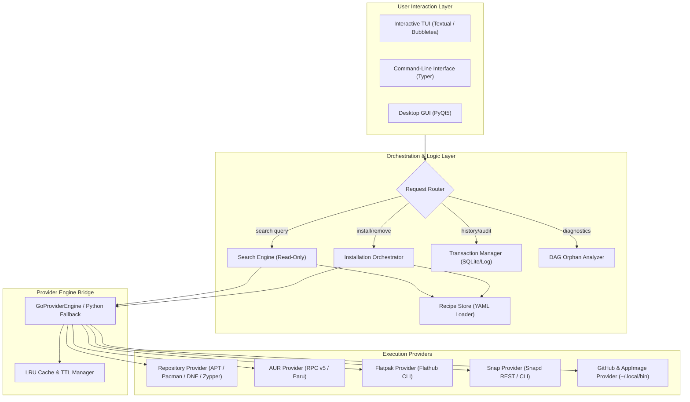

<div align="center">

# ⚡ Arjax

**The Next-Generation Universal Linux Package Engine & Interactive TUI**

*Unified Package Discovery, Declarative Recipes, and Automated Fallback Across Any Linux Distribution.*

[](./LICENSE)
[](https://python.org)
[](https://golang.org)
[]()
[]()

<br/>

<p align="center">
  <b>Accepted for Open Source Programmes:</b><br/>
  <a href="https://gssoc.girlscript.tech/">
    
  </a>
</p>

[Quick Start](#-quick-start) •
[Interactive TUI](#-interactive-terminal-ui-tui) •
[Architecture](#-system-architecture) •
[Declarative Recipes](#-declarative-recipes) •
[CLI Reference](#-cli-command-reference) •
[Contributing](#-contributing) •
[Discord Community](#-community)

</div>

---

## 🌟 Overview

**Arjax** is a fast, intelligent, cross-distribution package manager bridge designed for Linux. It eliminates the frustration of fragmented Linux packaging formats by unifying **native repositories (APT, Pacman, DNF, Zypper)**, **AUR**, **Flatpak**, **Snap**, and **GitHub Releases / AppImages** under a single, cohesive interface.

Whether you run **Pop!_OS**, **Ubuntu**, **Arch Linux**, **Fedora**, or **openSUSE**, Arjax automatically resolves packages through a prioritized provider chain, builds missing packages, or downloads native AppImages without requiring manual repository management or GitHub release scraping.

### Why Arjax?

* **Default Modern TUI**: Run `arjax` to launch a keyboard- and mouse-driven dual-pane terminal interface with real-time search feedback, dependency trees, and instant action buttons.
* **Separation of Concerns**: Package search is **100% read-only and safe**; installation is isolated in a separate, timed, step-based orchestration engine with transaction rollback.
* **Zero-Code Declarative Recipes**: Add support for complex software (like `zapfast`, `brave`, `vscode`, `docker`) using pure YAML recipes—no Python or Go code required.
* **Intelligent Fallback Chain**: If a package is absent from your distribution's native repository, Arjax seamlessly discovers GitHub releases, extracts AppImages, marks them executable in `~/.local/bin`, and registers desktop launcher shortcuts automatically.
* **System Health & Maintenance**: Includes transaction history logging, DAG-based orphaned package cleanup, disk cache analyzers, and snapshot rollbacks.

---

## 🖥️ Interactive Terminal UI (TUI)

Arjax launches its modern **Textual Terminal User Interface by default**. Simply execute `arjax` in your terminal.

```bash
# Launch interactive TUI (Default mode)
arjax

# Or explicitly via flag or subcommand
arjax --tui
arjax tui
```

```
┌───────────────────────────────────────────────────────────── arjax ─────────────────────────────────────────────────────────────┐
│ 🔍 [ Search packages (e.g. zapfast, firefox, vlc) — Press Enter or pause to search...                     ]                     │
├──────────────────────────────────────────────────────────────┬──────────────────────────────────────────────────────────────────┤
│ SEARCH RESULTS                                               │ PACKAGE DETAILS & DEPENDENCY TREE                                │
│ 📦 zapfast (recipe (repository, github, appimage)) latest    │ Name:        zapfast                                             │
│ 📦 zapfast-bin (pacman)                                      │ Provider:    recipe (repository, github, appimage)               │
│ 📦 zapfast-git (pacman)                                      │ Version:     latest                                              │
│                                                              │ Repository:  arjax-recipes                                       │
│                                                              │ Description: Fast native WhatsApp client built with Rust & egui  │
│                                                              │                                                                  │
│                                                              │ 📦 zapfast (latest)                                              │
│                                                              │  ├── 🔗 Provider Strategy: repository (paru: zapfast)            │
│                                                              │  ├── 🔗 Provider Strategy: github (crmne/zapfast)                │
│                                                              │  └── 🔗 Provider Strategy: appimage (zapfast-x86_64.AppImage)    │
│                                                              │                                                                  │
│                                                              │ [ Install (i) ]       [ Remove (r) ]                             │
├──────────────────────────────────────────────────────────────┴──────────────────────────────────────────────────────────────────┤
│ ✔ Found 3 package(s) for 'zapfast'. Press [i] to Install, [r] to Remove.                                                        │
└─────────────────────────────────────────────────────────────────────────────────────────────────────────────────────────────────┘
```

### Key TUI Features

1. **Live Typing Feedback & Dual-Search**:
   * **Typing Indication**: Immediate visual indication in the status bar while typing (`⌨ Typing: 'zapfast'`).
   * **Debounce Auto-Search**: Pausing for **0.5s** triggers auto-search automatically—no need to press Enter!
   * **Instant Enter Search**: Pressing `Enter` bypasses the debounce timer and triggers immediate search.
   * **Active Search Loading**: Shows `⏳ Searching for 'query'...` during background queries across native repos, recipes, and remotes.
2. **Mouse-Clickable & Keyboard-Wired Buttons**:
   * Click **`[ Install (i) ]`** or press `i` to trigger orchestrator installation.
   * Click **`[ Remove (r) ]`** or press `r` to safely uninstall packages and remove AppImage launchers.
3. **Real-Time Dependency & Strategy Tree**:
   * Arrow keys (`↑`/`↓`) navigate results and immediately update package descriptions, dependency hierarchies, and recipe multi-provider strategies.
4. **Shortcut Navigation Matrix**:

| Key | Action | Description |
| :---: | :--- | :--- |
| `/` | **Focus Search** | Move focus directly to the search input bar |
| `i` | **Install Package** | Install the currently highlighted package via orchestrator |
| `r` | **Remove Package** | Uninstall package and remove desktop launcher files |
| `d` | **Focus Tree** | Focus and navigate the dependency / provider strategy tree |
| `h` | **History** | Display transaction audit log with timing benchmarks |
| `o` | **Orphan Scan** | Scan orphaned packages via DAG dependency analysis |
| `s` | **System Dashboard**| View disk usage, package cache metrics, and health diagnostics |
| `u` | **Sync Recipes** | Synchronize declarative recipes from the central registry |
| `q` / `Ctrl+C` | **Quit** | Exit the TUI session cleanly |

> 📖 **Read the full TUI guide in [`docs/TUI_GUIDE.md`](./docs/TUI_GUIDE.md).**

---

## ⚡ Quick Start

### 1-Line Installation (Recommended)

Run the automated installer to scaffold a dedicated virtual environment, install CLI/TUI entrypoints, and register desktop shortcuts:

```bash
curl -fsSL https://raw.githubusercontent.com/AdmGenSameer/archpkg-helper/main/install.sh | bash
```

### Manual Installation

Clone the repository and install using `uv` (or standard `pip`):

```bash
# 1. Clone repository
git clone https://github.com/AdmGenSameer/archpkg-helper.git
cd archpkg-helper

# 2. Run installer script
bash install.sh

# 3. Or install into an active virtual environment
python3 -m venv .venv
source .venv/bin/activate
pip install -e .
```

### Quick Verification

```bash
# Verify installation and view detected distribution
arjax stats

# Search for a package (CLI output)
arjax search zapfast

# Install a package via orchestrator
arjax install zapfast
```

---

## 🏗️ System Architecture

Arjax utilizes a decoupled, high-performance architecture separating user interaction, orchestration, and provider execution.



### The 4-Step Installation Pipeline

Whenever `arjax install <package>` or the TUI Install action is triggered, Arjax executes a deterministic, 4-stage pipeline with millisecond benchmarking:

```
╭────────────────── Arjax ──────────────────╮
│ Package : zapfast                         │
│ Action  : Install                         │
╰───────────────────────────────────────────╯

▶ Resolving package...
✓ Found recipe: zapfast (WhatsApp Client)

▶ Selecting provider...
  repository   ...... not supported
  github       ...... queued (fallback)
  appimage     ...... selected
  flatpak      ...... queued (fallback)
  snap         ...... not supported

▶ Checking dependencies for appimage...
✓ Dependencies ready

▶ Running installation via appimage...
✓ Successfully installed zapfast via appimage to ~/.local/bin/zapfast
✓ Created desktop launcher at ~/.local/share/applications/zapfast.desktop

Installation Complete
───────────────────────────────────────
Resolving recipe.......... 18 ms
Selecting provider........ 4 ms
Checking dependencies..... 2 ms
Installing............... 1.42 s
Total.................... 1.44 s
───────────────────────────────────────
Package : zapfast
Provider: appimage
Time    : 1.44 s
Status  : Success
```

---

## 📖 Declarative Recipes

Arjax decouples software specifications from executable code using **declarative YAML recipes**. Recipes reside in `arjax/recipes/` (and user overrides in `~/.config/arjax/recipes/`).

### Example: WhatsApp Native Client (`zapfast.yaml`)

```yaml
name: zapfast
display_name: ZapFast
description: Fast native WhatsApp client built with Rust and egui
aliases:
  - zapfast
  - whatsapp

providers:
  repository:
    package: zapfast
    package_manager: paru
  github:
    github_repo: crmne/zapfast
  appimage:
    appimage_url: https://github.com/crmne/zapfast/releases/download/v0.21.1/zapfast-0.21.1-x86_64.AppImage
    appimage_name: zapfast
```

### Adding a New Recipe in 60 Seconds

1. Create `arjax/recipes/<package_name>.yaml`.
2. Specify package metadata and provider mappings (native packages, Flathub IDs, GitHub release URLs, or direct AppImages).
3. Test your recipe immediately:
   ```bash
   arjax install <package_name>
   ```

> 📖 **Read the complete specification in [`docs/RECIPES_SPEC.md`](./docs/RECIPES_SPEC.md).**

---

## 💻 CLI Command Reference

### Package Operations

```bash
# 1. Search packages (read-only, across all providers)
arjax search firefox
arjax search "video editor" --limit 10
arjax search neovim --aur-sortby votes

# 2. Install package(s)
arjax install brave
arjax install zapfast
arjax install vlc gimp htop      # Parallel multi-package installation

# 3. Explicit provider targeting
arjax install signal --provider flatpak
arjax install vscode --provider vendor
arjax install helix --provider github

# 4. Purpose-based software discovery
arjax suggest "video editing"
arjax suggest coding
arjax suggest --list             # List all available purpose categories
```

### Maintenance, History & Cleanup

```bash
# 1. System health and resource telemetry
arjax stats

# 2. Transaction history & Rollback
arjax history list               # View chronological audit trail with durations
arjax history rollback <tx_id>   # Revert an installation or removal transaction

# 3. DAG-based orphaned package cleanup
arjax cleanup orphans --dry-run  # Preview unneeded dependency trees
arjax cleanup orphans            # Safely purge orphaned packages

# 4. Cache maintenance
arjax cleanup cache              # Reclaim disk space from cached package downloads

# 5. Declarative recipe auto-sync
arjax recipes list               # Compare local recipes against upstream registry
arjax recipes sync               # Pull and update latest community recipes
```

---

## 🐧 Distribution Support Matrix

Arjax automatically identifies your host operating system and routes commands to native tools:

| Distribution Family | Primary Package Manager | Secondary / Fallback | Universal & Binary Support |
| :--- | :--- | :--- | :--- |
| **Arch Linux / Manjaro** | `pacman` | `paru` / `yay` (AUR) | Flatpak, Snap, AppImage |
| **Pop!_OS / Ubuntu / Debian** | `apt` / `apt-get` | PPA / Vendor repositories | Flatpak, Snap, AppImage |
| **Fedora / RHEL / CentOS** | `dnf` | RPM fallback | Flatpak, Snap, AppImage |
| **openSUSE / SLES** | `zypper` | OBS (Open Build Service) | Flatpak, Snap, AppImage |

### Testing in Docker (Pop!_OS / Ubuntu)

You can easily verify Arjax inside an isolated container:

```bash
docker run -it --rm popcon:latest bash -c "arjax --help && arjax stats"
```

---

## 🧪 Development & Testing

Arjax maintains strict quality standards with **100% test pass rates** and **Flake8 compliance**.

```bash
# Run the complete test suite (51 unit and async TUI tests)
uv run --with pytest-asyncio pytest

# Run style and PEP8 validation
uv run --with flake8 flake8 arjax/ tests/

# Compile the optional high-performance Go Provider Engine
cd arjax-provider-engine
go build -o bin/arjax-provider main.go
go test ./...
```

---

## 🤝 Contributing

We welcome contributions from developers of all skill levels! Whether you want to add a new YAML recipe, improve TUI widgets, or add support for another distro:

1. **Fork the repository** on GitHub.
2. **Create a branch**: `git checkout -b feature/amazing-feature`.
3. **Commit your changes**: `git commit -m "feat: add support for new feature"`.
4. **Verify tests pass**: `uv run --with pytest-asyncio pytest`.
5. **Push and open a Pull Request**.

Please review our [Contributing Guide](./CONTRIBUTING.md) and [Code of Conduct](./CODE_OF_CONDUCT.md).

---

## 💬 Community

Have questions, suggestions, or need help? Join our community:

<div align="center">
  <a href="https://discord.gg/bN7ycNdCR">
    
  </a>
</div>

---

## 📄 License

Arjax is licensed under the **[Apache License 2.0](./LICENSE)**. Free and open source software for everyone.
