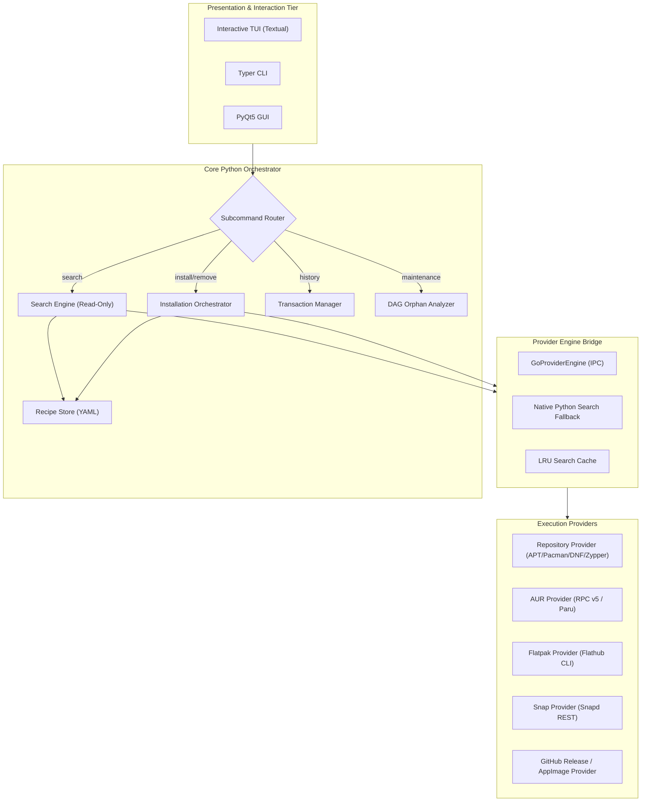
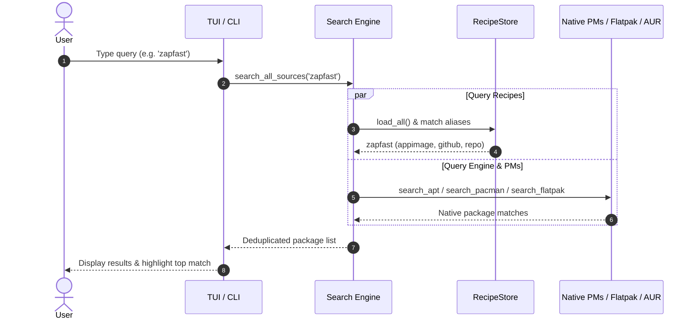
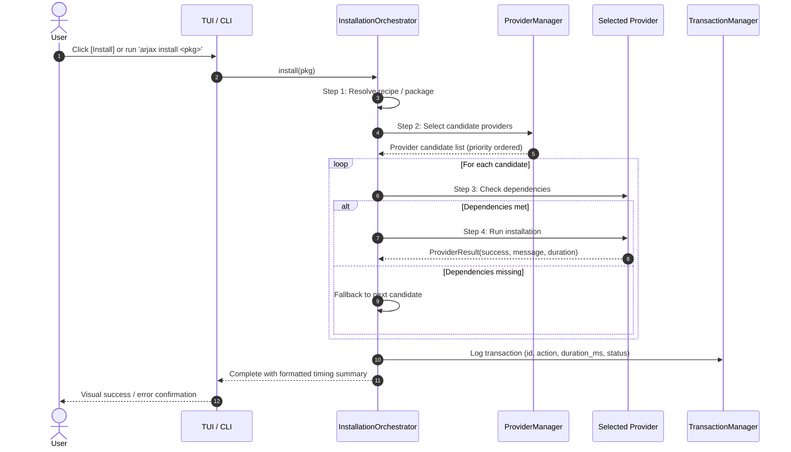

# 🏛️ Arjax System Architecture & Topology

Arjax separates **discovery (read-only search)** from **execution (isolated installation and state change)** across Linux distributions.

---

## 📐 High-Level Architecture

---

## 🔄 Search vs. Install Pipeline

### 1. Search Pipeline (Read-Only)

Search operations never require elevated privileges (`sudo`) and never alter system packages or state.

### 2. Installation Pipeline (Timed & Benchmarked)

---

## 📦 Provider Priority Matrix

When a package is installed, providers are evaluated strictly in the following priority order:

| Priority | Provider | Type | Description |
| :---: | :--- | :--- | :--- |
| **1** | `repository` | Native | Package manager detected on the host (`pacman`, `apt`, `dnf`, `zypper`). |
| **2** | `vendor` | Vendor | Third-party repositories or vendor repositories specified in recipe. |
| **3** | `github` | Binary / Source | Automated release resolution via GitHub REST API. |
| **4** | `flatpak` | Universal | Flathub containerized application. |
| **5** | `snap` | Universal | Canonical Snap Store package. |
| **6** | `appimage` | Standalone | Direct `.AppImage` executable placed in `~/.local/bin/`. |

---

## 🛡️ Reliability & Rollback

Every mutating operation (install, remove, rollback) is tracked in Arjax's **Transaction Manager**:
* Each transaction records: UUID, package name, provider, outcome, duration in milliseconds, and timestamp.
* The interactive TUI (`h` key) or CLI (`arjax history list`) provides real-time auditability.
* Failed transactions leave no lingering lock files or broken temporary extraction folders.

