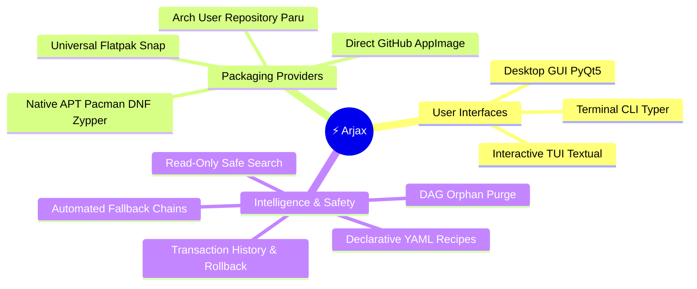

# ⚡ Arjax Documentation

Welcome to the official documentation for **Arjax** (the Next-Generation Universal Linux Package Engine).

Arjax simplifies software discovery and installation across diverse Linux distributions by providing a single, coherent workflow over **native package managers (APT, Pacman, DNF, Zypper)**, **AUR**, **Flatpak**, **Snap**, and **GitHub Releases / AppImages**.

---

## 🧭 Navigating the Docs

| Guide | Description |
| :--- | :--- |
| **[Quick Start](quickstart.md)** | Get Arjax running on your system in under 2 minutes. |
| **[Installation](installation.md)** | Installation methods: automated script, manual virtualenv, and Docker. |
| **[Distribution Matrix](distros.md)** | Supported distros: Arch, Pop!_OS, Ubuntu, Debian, Fedora, openSUSE. |
| **[Interactive TUI](TUI_GUIDE.md)** | Guide to the default dual-pane TUI, search feedback, and wired action buttons. |
| **[CLI Reference](cli.md)** | Complete CLI subcommands, flags, and command usage. |
| **[Architecture](ARCHITECTURE.md)** | Deep dive into system topology, request routing, and provider fallback pipelines. |
| **[Recipe Specification](RECIPES_SPEC.md)** | Write zero-code YAML recipes to add support for any software. |
| **[Maintenance](maintenance.md)** | Transaction history, rollback, DAG orphan scanning, and cache management. |

---

## 🎯 Key Capabilities



* **Interactive TUI by Default**: Run `arjax` to explore packages, inspect dependencies, and install/remove software with keyboard and mouse controls.
* **Separation of Concerns**: Searching is **strictly read-only**; installations run through an isolated, timed orchestration pipeline.
* **Automated Fallback**: If a package is missing from APT on Pop!_OS or Debian, Arjax can automatically resolve GitHub releases, extract AppImages, and generate desktop shortcuts.
* **Declarative Recipes**: Define custom applications cleanly with simple YAML files in `arjax/recipes/`.

---

## 🚀 Quick Run

```bash
# 1. Install via automated installer
curl -fsSL https://raw.githubusercontent.com/AdmGenSameer/archpkg-helper/main/install.sh | bash

# 2. Launch the interactive TUI
arjax

# 3. Or query packages directly from the CLI
arjax search zapfast
arjax install zapfast
```

